  

# 🚀 Awesome Crypto Analytics & Web3 Media 🌐

  
  
  
  
  

---

## 📌 Executive Summary & Repository Overview

A comprehensive, curated directory and technical benchmark of premier **SaaS/Hosted Platforms** and **High-Performance Open-Source Projects** engineered for **Crypto Analytics, On-Chain Telemetry, DeFi Protocol Indexing, Wallet Forensics, and Web3 Media Broadcasts**.

Whether you are an on-chain quantitative researcher decoding smart contracts with SQL, an enterprise compliance officer investigating multi-chain AML transaction flows, or a Web3 engineer deploying self-hosted block indexers and media streaming bots, this repository indexes the best-in-class tools across EVM, Solana, Bitcoin, and modular Layer-2 ecosystems.

---

## 📑 Table of Contents

- [📈 Sector Overview & Market Dynamics](#-sector-overview--market-dynamics)
- [🏢 SaaS & Hosted Analytics Platforms](#-saas--hosted-analytics-platforms)
- [💻 Open-Source GitHub Projects](#-open-source-github-projects)
- [🛠️ Recommended Architecture Combinations](#️-recommended-architecture-combinations)
- [🤝 How to Contribute](#-how-to-contribute)
- [💖 Support & Sponsorship](#-support--sponsorship)
- [⭐ Star History](#-star-history)
- [⚖️ Disclaimer](#️-disclaimer)

---

## 📈 Sector Overview & Market Dynamics

The global **blockchain analytics and crypto compliance market** is valued at approximately **$2.5B to $2.9B in 2025** and projected to surge to **$3.64B+ by 2026**, expanding at an aggressive CAGR of ~26% toward an estimated $10B–$14B by the early 2030s.

The sector exhibits a **concentrated oligopoly at the enterprise and government tier**, where a small cadre of well-funded giants (Chainalysis, TRM Labs, Elliptic) command the lion's share of high-stakes compliance and forensic contracts due to massive proprietary entity attribution networks and institutional moats. Conversely, the market remains **moderately fragmented across self-serve community research, decentralized indexing, and developer tooling**, where modular SQL layers, open-source data lakes, and local-first execution engines continue to emerge and challenge legacy providers.

---

## 🏢 SaaS & Hosted Analytics Platforms

The following hosted SaaS platforms are benchmarked by estimated company size (valuation / revenue), starting pricing tiers, and precise free tier limitations:

| Platform 🏷️ | Company Size (Valuation / Revenue) 💰 | Pricing (Starting Paid Tier) 💳 | Free Tier / Free Trial Limits 🎁 | Core Specialization 🎯 |
| :--- | :--- | :--- | :--- | :--- |
| **[Chainalysis](https://chainalysis.com)** | **$8.6B peak valuation** ($1.6B–$2.5B secondary; ~$150M–$250M ARR) | **Custom Enterprise quote** (~$40,000–$50,000+/year base license) | **Strictly no public free tier**; institutional free trials provided on request (typically 14-day gated trial with capped transaction tracing credits). | Enterprise blockchain compliance, forensic investigations, KYT transaction monitoring, and sanctions screening. |
| **[TRM Labs](https://trmlabs.com)** | **$2.0B valuation** ($220M+ total funding; Series C extension in 2026) | **Enterprise quote** (procurement base from £33,272 / ~$42,000/year for TRM Forensics) | **No self-serve free tier**; 14-day guided proof-of-concept / institutional trial with designated compliance analyst onboarding. | Multi-chain financial crime prevention, illicit address clustering, automated transaction screening, and sanctions detection. |
| **[Dune Analytics](https://dune.com)** | **$1.0B valuation** (Series B unicorn; Coatue-backed) | **$65/month** (Analyst Plan, billed annually; 4,000 credits/mo, 1 GB storage, basic API) | **Free forever plan**: View-only access to all public community dashboards and queries; **0 recurring execution credits** (cannot run custom queries on Free) and 0 GB write storage; **7-day free trial** with 2,500 one-time query credits for new users. | Decoded cross-chain SQL queries, user-generated dashboards, and Dune API endpoints. |
| **[Nansen](https://nansen.ai)** | **$750M valuation** ($75M Series B; acquired by The North Alliance; ~$11.9M ARR) | **$49/month** (Pro Plan, billed annually at $588/yr, or $69/mo; unlimited alerts, full Token God Mode) | **Free forever plan**: Unlimited basic wallet searches and curated dashboard views, capped at **50 active Smart Alerts** and 10 daily AI/API credits. | Smart money tracking, wallet profiling, token flow analysis, and exchange netflow signals. |
| **[Elliptic](https://elliptic.co)** | **$670M valuation** ($120M Series D in 2026; ~$30M annual revenue) | **Custom Enterprise quote** (tiered by screened volume and API request frequency) | **No permanent free tier**; offers a 14-day institutional pilot evaluation with limited sandbox wallet risk-scoring calls. | Cross-chain crypto AML, sanctions screening, wallet risk scoring, and automated compliance audits. |
| **[Glassnode](https://glassnode.com)** | **Institutional Tier** (Est. $15M–$30M ARR; privately funded) | **$34.30/month** (Advanced Plan, billed annually at $411.60/yr; or $49/mo; 4-year history, 300+ metrics) | **Free forever plan**: Standard tier with access to Basic (Tier 1) metrics, limited historical chart ranges (daily resolution), and **0 API export capabilities**. | Bitcoin, Ethereum, and macro on-chain economic metrics, UTXO age bands, and exchange reserves. |
| **[Flipside Crypto](https://flipsidecrypto.xyz)** | **$350M peak valuation** (Core data business transitioned to SonarX / edisyl) | **$200/month** (Builder Tier via SonarX / AWS Data Exchange; custom enterprise data shares) | **Free forever plan**: Public SQL queries, community data explorer, and public dashboard sharing with standard community query queue limits. | Decoded multi-chain SQL data warehouse, community analyst bounties, and data feeds. |
| **[Arkham Intelligence](https://arkhamintelligence.com)** | **$150M valuation** (VC Seed extension; $75M–$80M FDV ARKM token market cap) | **Free web suite / Custom API quote** (Token utility model via ARKM for Intel Exchange) | **Free forever plan**: 100% free web UI access for entity deanonymization, interactive graph visualization, and up to **10 custom real-time transaction alerts**; high-volume API requires application. | Blockchain address deanonymization, entity mapping visualizer, and Intel Exchange bounties. |
| **[Token Terminal](https://tokenterminal.com)** | **Series A backed** (Lifeline Ventures; private revenue) | **$350/month** (Pro Tier; includes full history, unlimited custom charts, team seats, 7-day trial) | **Free forever plan**: Full core historical on-chain metric charts, 3 custom dashboards, Google Sheets / Excel plugin access, CSV exports, and **500,000 requests/month**. | Institutional crypto financial fundamentals, protocol revenue, fee earnings, and Price-to-Fees (P/F) ratios. |
| **[Messari](https://messari.io)** | **$10M acquisition** (by Blockworks in June 2026; down from $300M peak valuation) | **Custom Enterprise quote** (institutional research, Copilot AI, advanced venture screening) | **Free forever plan**: Basic cryptocurrency price and volume metrics, 1 custom watchlist, and public quarterly research executive summaries (no API access). | Institutional crypto research, governance proposals tracking, fundraising databases, and token unlock schedules. |
| **[DefiLlama Pro](https://defillama.com)** | **Bootstrapped Public Good** (Operated under Llama Corp; ~$5M–$10M est. run-rate) | **$49/month** (Pro Plan; or $490/year; API plan available at $300/month) | **Free forever plan**: Unrestricted access to all public TVL, fees, revenue, token unlocks, and yield metrics; limited to **1 AI query/day**, 1 research report every 14 days, and **no CSV downloads or custom dashboard saving**. | Comprehensive DeFi Total Value Locked (TVL), volume metrics, protocol fees, and multi-chain stablecoin supplies. |

---

## 💻 Open-Source GitHub Projects

Explore the most powerful open-source crypto analytics, algorithmic trading backtesters, high-throughput indexers, and local blockchain data engines. Sorted strictly in descending order of GitHub stargazers:

- **[freqtrade/freqtrade](https://github.com/freqtrade/freqtrade)**   
  *Free, open-source crypto algorithmic trading bot and backtesting engine written in Python with complete historical market data ingestion, custom strategy analytics, and Telegram control.*

- **[duckdb/duckdb](https://github.com/duckdb/duckdb)**   
  *Ultra-high-performance columnar analytical database system optimized for zero-dependency local SQL queries against blockchain Parquet and CSV datasets at lightning speeds.*

- **[OpenZeppelin/openzeppelin-contracts](https://github.com/OpenZeppelin/openzeppelin-contracts)**   
  *The industry standard library for secure, audited smart contract development, providing canonical event telemetry architectures and access control interfaces across the EVM.*

- **[hummingbot/hummingbot](https://github.com/hummingbot/hummingbot)**   
  *Institutional-grade open-source framework for building high-frequency market-making, arbitrage, and cross-exchange liquidity analytics bots on centralized and decentralized exchanges.*

- **[foundry-rs/foundry](https://github.com/foundry-rs/foundry)**   
  *Blazing-fast, portable, and modular EVM development toolkit and testing environment written in Rust (`cast` CLI provides instant smart contract event analysis and RPC decoding).*

- **[paradigmxyz/reth](https://github.com/paradigmxyz/reth)**   
  *Modular, contributor-friendly, and blazing-fast Ethereum full/archive execution client built in Rust, engineered to maximize throughput for local blockchain data extraction.*

- **[blockscout/blockscout](https://github.com/blockscout/blockscout)**   
  *Leading self-hosted, full-featured open-source blockchain explorer and smart contract analytics platform for Ethereum, L2 rollups, and EVM sidechains.*

- **[rotki/rotki](https://github.com/rotki/rotki)**   
  *Privacy-first, local-first portfolio management, accounting, and on-chain analytics engine that encrypts all user transaction history and balances on the user's personal hardware.*

- **[erigontech/erigon](https://github.com/erigontech/erigon)**   
  *Efficiency-oriented Ethereum archive node implementation in Go, featuring dramatic disk space reductions and high-speed RPC responses for deep historical chain analysis.*

- **[graphprotocol/graph-node](https://github.com/graphprotocol/graph-node)**   
  *The foundational open-source indexing node for The Graph protocol, enabling developers to build and deploy GraphQL subgraphs that listen to and aggregate smart contract events.*

- **[blockchain-etl/ethereum-etl](https://github.com/blockchain-etl/ethereum-etl)**   
  *Python CLI tools for ETL (extract, transform, and load) pipelines converting Ethereum blocks, logs, transactions, token transfers, and internal traces into BigQuery, Parquet, and PostgreSQL.*

- **[paradigmxyz/cryo](https://github.com/paradigmxyz/cryo)**   
  *The fastest way to extract blockchain data directly from RPC endpoints to Parquet, CSV, or Arrow dataframes, developed by Paradigm in Rust for high-throughput quantitative pipelines.*

- **[otterscan/otterscan](https://github.com/otterscan/otterscan)**   
  *Blazing-fast, private, self-hosted Ethereum block explorer built to run locally against Erigon or Reth archive nodes without any third-party tracking or centralized APIs.*

- **[subsquid/squid-sdk](https://github.com/subsquid/squid-sdk)**   
  *High-throughput TypeScript ETL framework and decentralized data lake SDK capable of ingesting and decoding up to 50,000+ EVM and Substrate blocks per second.*

- **[DefiLlama/DefiLlama-Adapters](https://github.com/DefiLlama/DefiLlama-Adapters)**   
  *The official open-source code repository of community-maintained TVL adapters powering DefiLlama across thousands of DeFi protocols and hundreds of blockchains.*

- **[ponder-sh/ponder](https://github.com/ponder-sh/ponder)**   
  *Developer-first, zero-overhead TypeScript framework for building smart contract event indexers with instant hot-reloading and automatic GraphQL/SQL schema generation.*

- **[TrueBlocks/trueblocks-core](https://github.com/TrueBlocks/trueblocks-core)**   
  *Decentralized indexing engine written in Go and C++ that generates lightweight, local address-appearance indexes directly from an Ethereum RPC node.*

- **[enviodev/hyperindex](https://github.com/enviodev/hyperindex)**   
  *Ultra-fast, modular multichain event indexer engineered for real-time GraphQL API delivery and cross-chain EVM data aggregation.*

- **[indexsupply/shovel](https://github.com/indexsupply/shovel)**   
  *Ultra-lightweight, zero-dependency Go indexer that streams decoded EVM events directly into PostgreSQL tables with minimal configuration.*

- **[click6067-ship-it/token-tv](https://github.com/click6067-ship-it/token-tv)**   
  *Open-source Web3 streaming media interface engineered to broadcast real-time token market feeds, chart visualizations, and interactive on-chain broadcasts.*

- **[graphsense/graphsense-lib](https://github.com/graphsense/graphsense-lib)**   
  *Academic-grade open-source cryptocurrency forensics platform providing transaction graph analytics, wallet clustering, and money-flow pathfinding across Bitcoin and EVM chains.*

---

## 🛠️ Recommended Architecture Combinations

Maximize your data stack efficiency with these battle-tested architectural recipes:

1. **Local-First Dune Alternative (Zero Cloud Cost)**:
   - Extract raw RPC logs and transactions using **`paradigmxyz/cryo`** directly into Parquet files.
   - Run millisecond analytical SQL queries and dashboard calculations using **`duckdb/duckdb`**.
2. **High-Speed Decentralized dApp Indexing**:
   - Ingest smart contract logs with **`ponder-sh/ponder`** or **`subsquid/squid-sdk`**.
   - Stream decoded records into PostgreSQL via **`indexsupply/shovel`** and expose via auto-generated GraphQL.
3. **Private, Self-Hosted Explorer & Forensics**:
   - Run an **`erigontech/erigon`** or **`paradigmxyz/reth`** local archive node.
   - Attach **`otterscan/otterscan`** for browser inspection and **`graphsense/graphsense-lib`** for entity heuristics.
4. **Interactive Web3 Broadcast Media & Live Streams**:
   - Ingest price and volume telemetry with **`freqtrade/freqtrade`** and **`DefiLlama-Adapters`**.
   - Render interactive media streams using **`click6067-ship-it/token-tv`**.

---

## 🤝 How to Contribute

Contributions are warmly welcomed! Help keep this repository the premier destination for on-chain analytics and Web3 media intelligence:

1. **Fork the Repository** on GitHub.
2. **Create a Feature Branch** (`git checkout -b feature/new-analytics-tool`).
3. **Add your Tool**: Ensure it fits either the SaaS table (with pricing, free tier limits, and company size) or the Open-Source section (with valid GitHub repository link and Stars_Badge).
4. **Verify Links & Syntax**: Ensure markdown formatting conforms to repository standards.
5. **Open a Pull Request** with a concise description of the platform's merits.

For an extensive collection of curated lists, check out [Awesome-Awesome-Awesome](https://github.com/ishandutta2007/Awesome-Awesome-Awesome).

---

## 💖 Support & Sponsorship

If this curated intelligence directory saved you research hours or supercharged your Web3 data pipeline, please consider supporting its ongoing maintenance:

- ⭐ **Star this repository** to improve visibility across the open-source community.
- 🍴 **Fork & Share** with your colleagues, DAO members, and on social channels.
- ☕ **Sponsor the Maintainer**: Buy a coffee or sponsor ongoing development via the [GitHub Sponsors Dashboard](https://github.com/sponsors/ishandutta2007).

  

---

## 📊 Star History

---

## ⚖️ Disclaimer

*This repository is an open-source, community-driven educational directory. The information provided does not constitute financial, investment, accounting, or legal advice. Software licenses, pricing tiers, and API limitations are subject to change by their respective providers. Always perform independent technical and security verification before deploying any software or interacting with blockchain smart contracts.*
